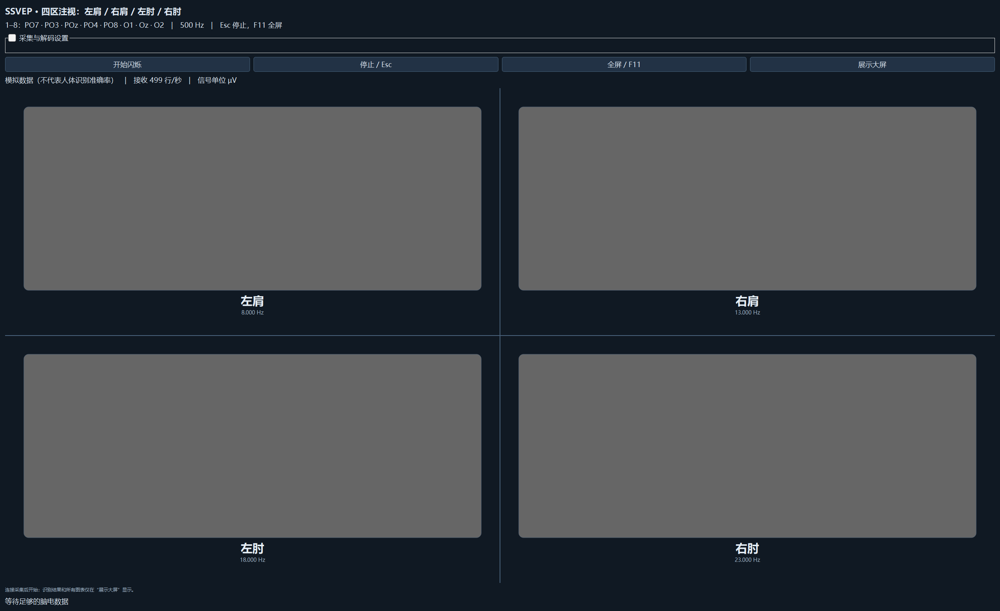
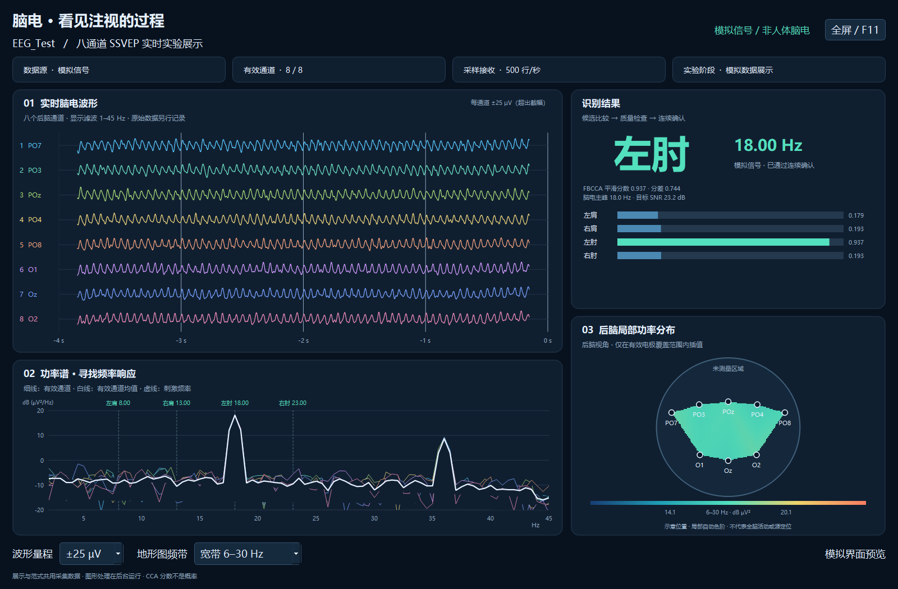

# EEG_Test 八通道 SSVEP demo

四个刺激区按不同频率改变亮度，观众窗口显示部位、频率及实时图表。支持“脑电模式”（FBCCA 解码）和“测试模式”（鼠标最近进入的四分区决定结果）；两种模式均照常采集、显示及保存原始数据。保留 USB 串口、WiFi TCP、模拟信号三种来源，现有固件和接线无需修改。

## 四区布局

| ID | 位置 | 标签 | 原整帧方案（60 帧/秒，默认） | 可选宽频方案 |
|---|---|---|---:|---:|
| 1 | 左上 | 左肩 | 8.571429 Hz | 8 Hz |
| 2 | 右上 | 右肩 | 12 Hz | 13 Hz |
| 3 | 左下 | 左肘 | 15 Hz | 18 Hz |
| 4 | 右下 | 右肘 | 20 Hz | 23 Hz |

横、竖划分线隔开四区，刺激块向四角分开，中央留白随窗口大小调整：左右闪烁块间距为窗口宽度的 10%（96–240 像素），上下两组（包含名称与频率）的间距为刺激面板高度的 14%（80–180 像素）。名称以 30 像素字号固定放在块正下方，频率再占一行，文字不参与闪烁。测试模式仍覆盖完整四分区，中央留白也可选区。范式窗口已移除分类结果、分数条和频谱；开始后收起设置，结果和图表集中在“展示大屏”。



通道仍为 `1–8 = PO7, PO3, POz, PO4, PO8, O1, Oz, O2`，REF/BIAS 使用原有接口。四个部位名称是 SSVEP 选择标签。

## 启动

在 `EEG_Test` 根目录打开 PowerShell，不要同时用串口监视器或 FIFO_plot 占用同一 COM 口：

```powershell
# 默认原整帧方案 + FBCCA；按实际端口修改 COM6
.\.venv\Scripts\python.exe SSVEP\run_demo.py --port COM6

# 测试模式：真实串口采集与图表，鼠标区域决定结果
.\.venv\Scripts\python.exe SSVEP\run_demo.py --port COM6 --mode test

# 独立串口发分类结果到另一台上位机；COM7 不能与采集口相同
.\.venv\Scripts\python.exe SSVEP\run_demo.py --port COM6 --result-port COM7

# 宽频 8/13/18/23 Hz + FBCCA
.\.venv\Scripts\python.exe SSVEP\run_demo.py --port COM6 --frequency-profile wide

# 明确标识的模拟信号，仅验证软件
.\.venv\Scripts\python.exe SSVEP\run_demo.py --simulate --frequency-profile wide

# 已烧录 WiFi 固件时，填写板子实际 IP
.\.venv\Scripts\python.exe SSVEP\run_demo.py --tcp 192.168.137.122 --tcp-port 3333

# CCA 对照；--no-audience 表示启动时不自动打开展示
.\.venv\Scripts\python.exe SSVEP\run_demo.py --decoder cca --no-audience
```

1. 在设置中选择运行模式、频率方案、数据源，点击“连接采集”。脑电模式可调整分数/分差门限；模拟数据源可选注入目标。
2. 确认接收约 500 行/秒。通道质量异常仅提示，不再阻止开始。
3. 可选择“记录标签：注视某部位”保存手工声明的真值；这个标签不会传给分类器。自由注视记为 0。
4. 点击“开始闪烁”，设置自动收起。脑电模式默认 3 秒窗、每 0.5 秒更新，两次连续确认后显示结果，首次通常约 4 秒。测试模式将鼠标移入任一对应四分区（包含不闪烁的文字和空白），无需点击，即显示对应部位和该区频率。
5. 默认 20 秒停止。Esc、停止按钮、切到其他应用或将范式最小化均停止；展示窗口 Esc 也有效。范式 F11 切换全屏会先结束本轮，之后重新开始。

切换频率方案会断开采集、重建展示并清空旧结果，之后重新连接，防止沿用旧的模拟频率或标记。刺激运行中不能修改运行模式、频率、分类方法、门限或标签。现有 `.venv` 已包含依赖，其他环境安装 `SSVEP/requirements.txt`。

## 发结果到另一台上位机

设置新增“结果输出串口”：选择独立的 USB 转串口端口（例如采集板 COM6、结果输出 COM7），波特率默认 115200，点击“连接结果串口”。两台电脑各接一个同类型 USB 转串口，接线、完整协议和接收端运行方法见 [结果串口协议](RESULT_SERIAL_PROTOCOL.md)。输出默认不自动连接；指定 `--result-port COM7` 则启动后连接。

采用 `RESULT,序号,模式,目标编号,频率\r\n`，例如 `RESULT,42,EEG,3,15.00\r\n`，8N1、无流控。编号 1–4 依次为左肩、右肩、左肘、右肘，0 表示未确认/停止。发送给另一台上位机的模式字段统一为 **`EEG`**，脑电、鼠标测试和模拟源均使用相同标记；实际来源和运行模式仍保存在本机图表标识及会话日志中。频率取当前目标的实际设定值，不是脑电主峰。

状态变化时发送，每 0.5 秒重复当前状态。无确认、停止或结果超过 1.5 秒不更新时归零。发送在独立后台线程进行，只保留最新状态；状态行显示连接及完整写入数量，最后一帧可悬停查看。图表及简洁的测试模式结果卡片维持原样。主动断开/退出时尝试发送最后一条 0；物理断线时接收端须自行按 1.5 秒超时作废。

附带 [receive_results.py](receive_results.py)，与 `result_serial.py` 一同复制到接收电脑后只需安装 `pyserial`，无需安装整套脑电软件。输出状态计数表示本机写入，不包含对端 ACK。

## 测试模式

设置中“运行模式”选择“测试模式”，或启动时指定 `--mode test`。它与数据源独立：选择 USB/TCP 时图表使用板卡实测数据，选择模拟数据时图表明确标为模拟数据。测试模式不启动脑电分类线程，不等待分类窗、质量门限或 SNR。

检测整个刺激面板的四分区：左上为左肩、右上为右肩、左下为左肘、右下为右肘。每区的闪烁块、名称、频率文字、边缘留白均可选择；中心竖线归右侧，中心横线归下侧。顶部设置栏和其他窗口不参与选区。进入另一区时立即更新，移出整个刺激面板仍保持最近选择，同一区内移动也不清除。尚未进入任何区时结果卡片留空。开始前可预选，停止后保留选择供下次开始使用；切换运行模式或频率方案清空选择。切换到其他应用仍按原有规则停止闪烁，本轮最后结果保留。

范式及展示窗口顶部保留“测试模式”标识；大屏结果卡片只居中显示部位名称和对应 Hz，运行中与停止后样式一致，去掉卡片标题、副标题、最近结果/选择保持等说明、四个候选标签和图表提示。界面不再反复标注“鼠标结果”或“来源：鼠标”。不显示伪造的 CCA 分数、概率或脑电主峰。显示的 Hz 是所选刺激区的设定频率，不能当作从脑电检测出的频率。原始数据照常记录，日志仍保留 `result_source=mouse` 及最近选择时间，不会覆盖手工实验标签。

闪烁可能引起不适，出现不适立即按 Esc 停止。有光敏性癫痫病史者不应进行闪烁实验，参见 [Epilepsy Foundation](https://www.epilepsy.com/what-is-epilepsy/seizure-triggers/photosensitivity)。自制采集板连接人体前应确认供电、保护及 USB 隔离；demo 未验证硬件的人体电气安全。

## 频率差距与时序

宽频方案相邻间隔为 5 Hz，原方案在 60 帧/秒时的最小间隔为 3 Hz。较大间隔可减少相邻频谱重叠，但实际分类还受诱发响应、自然 α 活动、谐波、接触和显示时序影响，不能保证人体准确率提高。建议按目标均衡标注多个完整试次，比较正确率、未确认率和延迟，再选择个体表现较好的方案。

原方案使用整数帧周期，60 帧/秒时分别为 7/5/4/3 帧；其他刷新率重新搜索并避开基频整数倍关系。宽频方案在帧序号上采样正弦亮度，周期可以不是整数帧，因而能计划生成固定的 8/13/18/23 Hz；需要软件更新率高于 46 帧/秒，尤其高频目标需验证实际出光。刷新率对灵活频率刺激的限制参见 [Nakanishi 等，2014](https://journals.plos.org/plosone/article?id=10.1371/journal.pone.0099235)。

程序按屏幕刷新率的整数分频，选择接近 60 帧/秒的软件更新率。当前 240 Hz 屏幕计划更新 60 帧/秒。`--refresh-hz` 仅用于纠正 Qt 错报，须与真实设置一致；运行中不要移到不同刷新率的屏幕上。

QWidget 绘制配合高精度时钟和绝对期限调度，卡顿后跳过相位，不密集补帧。脑电模式最近数据窗中，帧率偏离计划超过 7%、长帧比例超过 5%、单帧超过三个计划周期或画面中断时，拒绝确认并重置平滑证据，获得完整稳定窗后恢复。测试模式的鼠标结果不依赖这道时序门限。

**CPU 绘制完成时间不是屏幕出光时间，也不证明垂直同步。** 严谨实验需用光电二极管验证频率和时序。

## 分类与输出

默认使用无需训练的 FBCCA，保留 CCA 对照。保持 SRB1 硬件参考，不默认平均参考，不把 Oz 当眼电通道剔除。

FBCCA 在 50 Hz 陷波后，使用五个四阶 Butterworth 频带 `6–90、14–90、22–90、30–90、38–90 Hz`，分别与含前三次谐波的正弦/余弦参考作 CCA。权重为 `n^(-1.25)+0.25`，归一化后对相关系数平方加权再开平方，使展示分数处于 0–1。这是滤波器组 CCA 的 demo 实现，滤波器配置不等同于原论文实验，方法依据为 [Chen 等，2015](https://doi.org/10.1088/1741-2560/12/4/046008)。

解码前自动跳过常量通道及至少半数样本贴近 ADC 满量程的通道，不再要求至少三路质量合格。只剩一路有变化的通道也继续计算；对所用通道以中位数去中心、MAD 的六倍截断突发尖峰，再进行滤波和 FBCCA。此处理不改动保存的原始信号，也不是个体训练模型。没有任何可用变化时分数为零，不凭空生成脑电证据。

当前默认确认条件：

- 分数指数平滑 `alpha=0.60`；当前第一名须与平滑第一名一致，当前分数也须达标。
- 平滑分数至少 **0.22**，平滑分差至少 **0.015**，FBCCA/CCA 共用；两项均可在设置中进一步调低。当前窗分差至少为设置门限的一半。
- SNR 继续计算和显示，**不再硬性拦截**。信号区约为目标 ±0.55 Hz，背景距目标 1.5–3.5 Hz，并避开其他候选基频。
- 连续**两次**通过后确认。通道质量、幅度和接收速率异常只提示；数据缺失/非有限值、断流、刺激后数据不足和画面时序异常仍会阻止脑电确认。候选改变或证据不足时显示未确认，不把旧结果当当前指令。

这些门限是启发式参数，分数不是概率，重叠窗也不是独立实验。放宽门限、取消质量和 SNR 阻断能减少“无结果”，也会增加噪声、自然 α 波造成的误识别；更容易输出不代表人体准确率提高。

当前没有用本人的带标签试次拟合模型，也没有人体准确率结论。个体模板/训练模型需要每类多个标注试次及不注视目标的对照，并按完整试次划分训练/验证，防止重叠窗随机划分造成泄漏。

## 观众窗口



- 八通道波形：最近约 4 秒，展示专用 1–45 Hz 滤波，±25/50/100/200 µV 量程；无效通道灰色。初连时积累 1/2/4 秒窗，滤波两端各去掉 0.15 秒。
- 功率谱：2–45 Hz，有变化的通道细线、均值白线和四个频率标记；单位 `dB (µV²/Hz)`。质量异常不再隐藏全部图表。
- 后脑局部功率图：6–30 Hz 或目标 ±1 Hz，单位 `dB µV²`；在有变化的电极覆盖范围内插值，质量异常电极黄色标记，未测量处留空，少于三路有变化电极不生成热图。电极是后脑视角示意位置，不能用于全脑活动或源定位判断。
- 结果：脑电模式展示部位、频率、方法、平滑分数、分差、SNR、脑电主峰和未确认原因，结束后标为本轮最近结果；测试模式只展示部位和对应频率，结束后保持相同简洁样式。运行模式和模拟信号均明确标识，具体结果来源保留在日志中。

独立 Python 进程负责展示，后台线程通过有界队列接收采集缓存副本和结果，只取最新数据，不另开串口，也不改动原始数据及解码输入。波形最多每秒更新 10 次，功率谱每 0.5 秒计算一次。

“展示大屏”可调出窗口；关闭它只隐藏，不断开采集；关闭范式会回收展示进程。双屏投影使用 Windows“扩展”，展示优先放另一屏并可独立 F11 全屏。单屏避免遮住刺激区。两个实验窗口之间切换不停止，切到其他应用则停止。

## 数据与记录

读取八路有限数值 `channel:v1,...,v8`，从伏特转换为 µV，保存所有原始通道。去趋势标准差低于 0.25 µV、峰峰值超过 2000 µV 或长期贴近满量程会标为质量异常；“质量通过”计数可以正确显示 1/8、2/8，不再把少于三路统一写成 0/8。接收速率偏离 500 Hz 超过 12% 仅提示。脑电解码使用上述独立稳健预处理，不再把这些质量条件作为整窗阻断；全零没有可用于分类的变化，断流超过 0.6 秒仍不输出脑电确认。测试模式不以脑电质量或分类分数决定鼠标结果。

每轮保存到 `SSVEP/sessions/时间/`：

- `raw_eeg.csv`：样本序号、PC 接收时间、刺激状态、手工标签和八路原始 µV。
- `frames.csv`：帧序号、`paint_finished_monotonic_s`；历史 OpenGL 版本列名是 `swap_monotonic_s`。
- `decisions.jsonl`：脑电结果保存 `mode=eeg`、`result_source=eeg`、方法、原始/平滑分数、候选、确认、SNR、连续次数、质量提示、实际所用通道及频谱；FBCCA 另保存各子带分数。测试结果保存 `mode=test`、`mode_name=测试模式`、`result_source=mouse`、当前输出时间、最近选择时间、目标及区域频率，不混入脑电分数。
- `session.json`：通道、显示及频率方案、目标名称和布局、运行模式、结果来源、模型参数、门限、数据源、标签和记录完整性。

连接结果串口时，`session.json` 另保存发送端口/参数、起止写入数量及状态快照。原始脑电记录格式不变。

历史名称/频率以各自 `session.json` 为准，不要将旧“上/下/左/右”记录直接当作新部位。自由注视标签 0 及测试模式鼠标结果不能直接用于算脑电准确率。协议没有硬件采样序号，PC 到达时间也不能证明 ADC 未丢样。

## 验证

```powershell
.\.venv\Scripts\python.exe -B -m unittest discover -s SSVEP -p 'test_*.py' -v
```

43 项测试覆盖两套频率、CCA/FBCCA 四分类、噪声/非目标干扰、直流/置换/秩亏、目标切换、SNR 和数据检查、时序拒绝、TCP 拆包、单位及插值范围，以及鼠标选择保持/切换、结果来源记录、低门限、单通道解码、尖峰处理和全常量不产生脑电证据。结果串口测试使用 pyserial `loop://` 软件回环，覆盖帧格式、拆包/粘包、异常帧恢复、端口冲突别名、结果过期/乱序、模式/序号、写入失败、停止归零及接收脚本 CSV 记录，不会打开物理 COM 口。

两套频率方案此前各做过 20 秒静态灰块、模拟采集、FBCCA 与观众展示并行测试，软件更新约 60 帧/秒。

低门限及测试模式首次加入时，做过两种模式各约 12 秒的静态灰块桌面联动测试：脑电模式只保留 Oz 一路变化、其余七路常量满量程，仍输出注入的左肘；测试模式七路大幅度模拟数据加一路常量满量程，质量通过 0/8，实时波形、功率谱和局部功率图继续显示，保存超过 6000 行原始数据且手工标签不变。还验证停止重启保留选择、切换模式清空选择和辅助进程回收。两种模式均约 60 帧/秒，无超过 25 ms 的长帧。这些是软件链路验证，不是人体准确率或实际出光时序验证。

四分区选区调整后，再次通过静态桌面联动验证：四区的名称、频率文字和边缘留白均能选择，移出面板保持最近结果；范式及展示仅保留“测试模式”标识，不再显示鼠标来源说明，而日志保留来源字段。实时图表和原始数据记录继续工作。

加入结果串口后，再做了两种模式各约 12 秒的静态灰块、模拟采集、观众窗口与串口回环并行验证：分别接收 37/41 帧，编号和频率正确、序号递增，停止后归零；软件更新均约 60 帧/秒，最长间隔小于 20 ms。实际两台电脑和 USB 转串口模块的物理连接仍需接线后联调。
